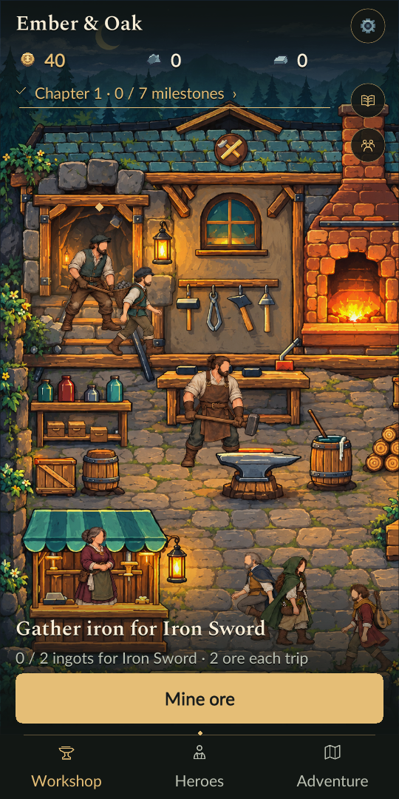
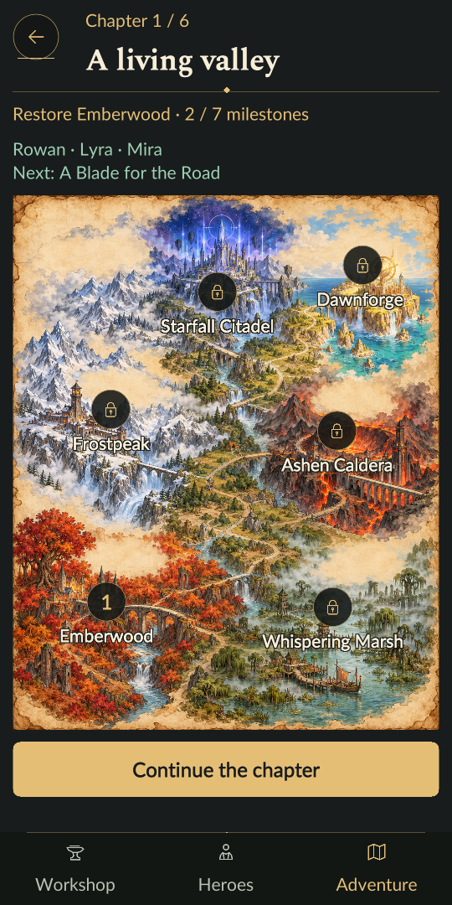
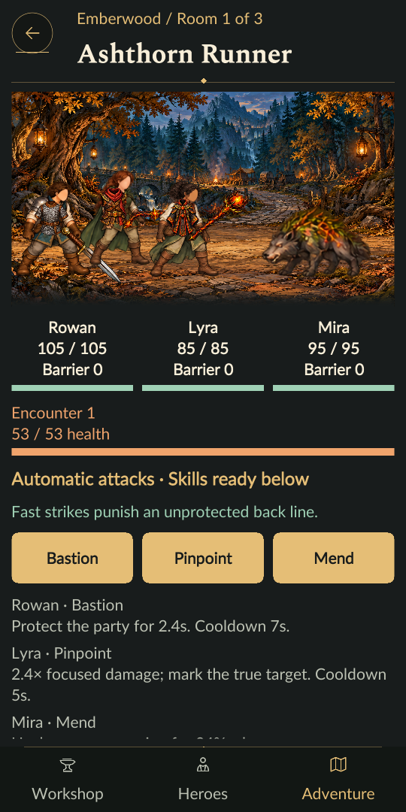

# Idle Blacksmith v2 — Ember & Oak

Game bengkel pandai besi untuk Windows dan Android, dengan workshop hand-drawn, produksi otomatis, artisan crafting dan ekspedisi party. Versi proyek saat ini: **0.6.0 — Chronicles**.



 

## Baru di 0.6.0

- Enam wilayah, enam hero, party tiga anggota, 108 pola equipment, 48 jenis enemy dan 12 guardian dengan tiga fase.
- Artisan bench: alloy, timing shaping, quench dan rune dengan perubahan statistik/efek yang nyata; pekerjaan otomatis bisa diambil alih tanpa membayar bahan resep dua kali.
- Rute bercabang dengan risiko, camp dan kesehatan yang dibawa antar ruang; role skills dan counter guardian yang mengikuti telegraph.
- Enam proyek restorasi, potret/percakapan warga, trust, legendary commissions, challenge ranks dan legacy pilihan yang mempertahankan koleksi.
- Equipment tampak pada hero, pose aksi/berjalan yang lebih lengkap, efek atmosfer wilayah, musik dinamis, ambience dan impact material.
- Semua wajah manusia polos tanpa mata, hidung dan mulut, sesuai arahan visual terbaru.
- Koleksi pola dan tujuan bab terlihat; teks 100/125/150%, Reduced motion dan save lama tetap didukung.

Panduan terbaru: [Chronicles](docs/PLAYING-CHRONICLES.md). Data konten dan alat validasi dijelaskan di [CONTENT-AUTHORING](docs/CONTENT-AUTHORING.md); kit playtest manusia ada di [PLAYTEST-CHRONICLES](docs/PLAYTEST-CHRONICLES.md).

## Fondasi ilustrasi 0.5.0

- Dua puluh equipment dengan ilustrasi baru untuk seluruh resep, storage, hero, hasil tempa dan workshop.
- Lima enemy dan lima guardian berbeda, masing-masing dengan empat pose hand-drawn.
- Peta ilustrasi dan lima arena wilayah; artwork yang sama juga dipakai pada hero, cerita dan jurnal.
- Nama seluruh wilayah, tujuan aktif, status restorasi dan preview syarat membuka wilayah terkunci.
- Bayangan yang menapak, gerak kontak/settle, telegraph lembut, serta ikon tinta yang halus.
- Penjelasan pembukaan bab, elemen perlengkapan dan reservasi barang yang lebih tepat. Save dan keseimbangan permainan tetap kompatibel.

Arahan dan prompt produksi: [illustrated-world-generation.md](ArtSource/illustrated-world-generation.md). Aset hasil imagegen disertakan di `Game/Assets/Resources/Art/HandDrawn`; generator analisis hanya membaca alpha dan menulis metadata.

## Alur bermain

Tambang bijih → lebur ingot → tempa perlengkapan → pakai pada hero → jelajahi wilayah → buka perkembangan bengkel berikutnya.

- Enam bab dengan 42 milestone dan arahan tindakan berikutnya.
- 108 resep, enam hero, enam wilayah, penyelamatan warga dan 36 cerita.
- Pesanan guild, reputasi, dan koleksi kualitas Masterwork.
- Pekerja otomatis dan progres offline hingga delapan jam.
- Penempaan manual dengan timing pukulan, hasil yang langsung bisa dipakai, dan perlindungan barang untuk tujuan/pesanan.
- Ukuran teks 100/125/150% dan Reduced motion.

Lihat [panduan bermain terbaru](docs/PLAYING-CHRONICLES.md) dan [verifikasi 0.6.0](docs/VERIFICATION-0.6.0.md). Catatan [verifikasi 0.5.0](docs/VERIFICATION-0.5.0.md) dipertahankan sebagai riwayat rilis sebelumnya.

## Membuka proyek

1. Clone repositori ini.
2. Pasang **Unity 6000.3.20f1** melalui Unity Hub. Untuk Android, sertakan Android Build Support, SDK/NDK, dan OpenJDK.
3. Tambahkan folder **`Game`** sebagai proyek Unity, lalu buka.
4. Buka scene `Assets/ForgeEmpire/Workshop.unity` dan tekan Play.

Aset yang dipakai game sudah disertakan. Pembuatan ulang ilustrasi atau audio tidak diperlukan untuk membuka proyek. Font Lato dan Spectral beserta lisensi OFL berada di `Game/Assets/Resources/Fonts`.

## Build

Titik masuk build berada di `Game/Assets/ForgeEmpire/Editor/ForgeBuild.cs`:

| Method | Keluaran |
| --- | --- |
| `ForgeEmpire.Editor.ForgeBuild.Desktop` | `Builds/Windows/ForgeEmpire.exe` |
| `ForgeEmpire.Editor.ForgeBuild.Android` | `Builds/Android/ForgeEmpire.apk` |
| `ForgeEmpire.Editor.ForgeBuild.Delivery` | Windows dan Android |

Jalankan method yang dipilih melalui opsi Unity `-executeMethod`. Contoh PowerShell untuk instalasi Unity standar di Windows:

```powershell
& 'C:/Program Files/Unity/Hub/Editor/6000.3.20f1/Editor/Unity.exe' `
  -batchmode -quit `
  -projectPath "$PWD/Game" `
  -executeMethod ForgeEmpire.Editor.ForgeBuild.Delivery `
  -logFile "$PWD/QA/build.log"
```

Tutup editor yang sedang memakai proyek sebelum menjalankan build batch. Build Android menggunakan ARM64, minimum API 26, target API 36, dan version code 6. Build script menghasilkan release build; alat pengujian hanya aktif melalui argumen khusus dan memakai profil simpan terpisah.

## Tes

Dengan Node.js dan Unity terpasang di lokasi standar Windows di atas:

```powershell
node tools/test-core.mjs local
node --test tests/art.test.mjs tests/illustrated-art.test.mjs tests/chronicle-content.test.mjs tests/chronicles-art.test.mjs
node tools/validate-chronicle-content.mjs
```

Tes logika memakai compiler C# dan runtime .NET yang disertakan Unity; hasil ditulis ke `QA/`. Jika Unity dipasang di lokasi lain, sesuaikan variabel `data` di `tools/test-core.mjs`.

Untuk menguji APK yang sudah di-build pada emulator Android yang aktif:

```powershell
node tools/test-native-android.mjs progression emulator-5562
node tools/test-native-android.mjs regression emulator-5562
node tools/test-native-android.mjs illustrated emulator-5562
node tools/test-native-android.mjs chronicles emulator-5562
```

Ganti serial dengan serial emulator dari `adb devices`. Runner ini menerima serial emulator saja dan memakai profil simpan QA terpisah. ADB dibaca dari `%LOCALAPPDATA%/Android/Sdk/platform-tools/adb.exe`.

## Isi repositori

| Folder | Isi |
| --- | --- |
| `Game/Assets/ForgeEmpire` | Simulasi, tampilan, animasi, penyimpanan, build dan probe native |
| `Game/Assets/Resources` | Ilustrasi, spritesheet, audio dan font |
| `Game/Packages`, `Game/ProjectSettings` | Dependensi dan pengaturan Unity |
| `ArtSource` | Sumber Aseprite, generator dan arahan ilustrasi |
| `tests`, `tools` | Tes logika/aset dan alat bantu |
| `docs`, `DESIGN-IS-2026-10-24` | Panduan, spesifikasi, rencana dan audit desain |

Cache Unity, hasil build, rekaman QA dan data simpan lokal tidak dimasukkan ke Git.
